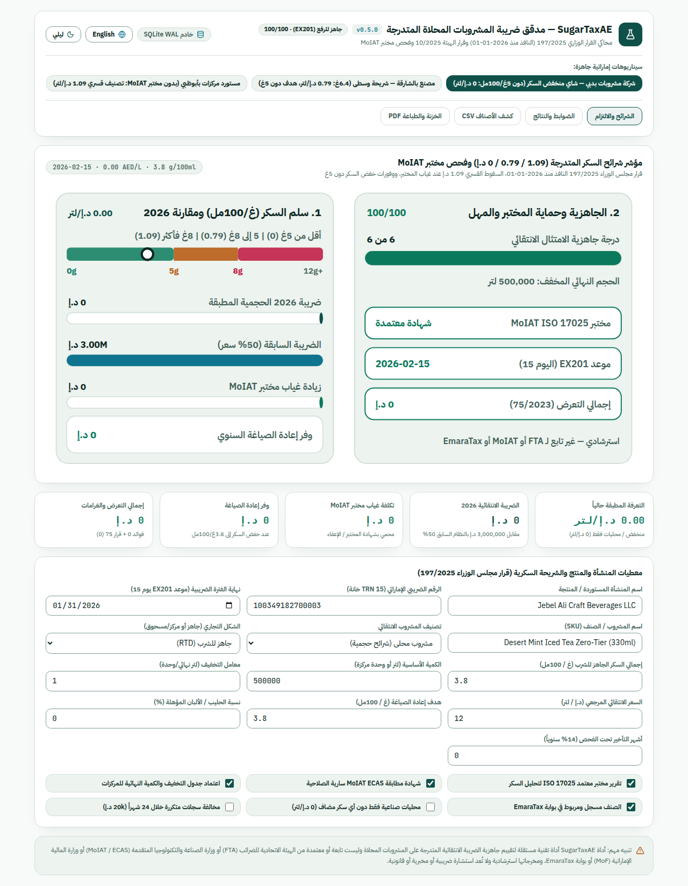
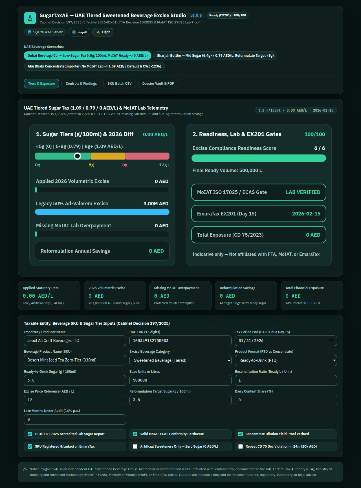
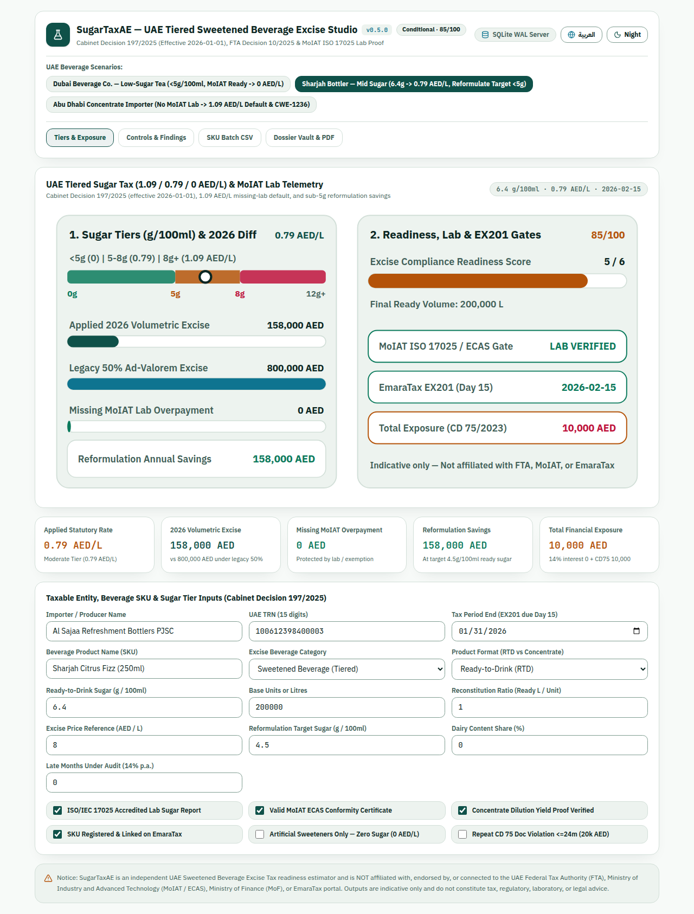
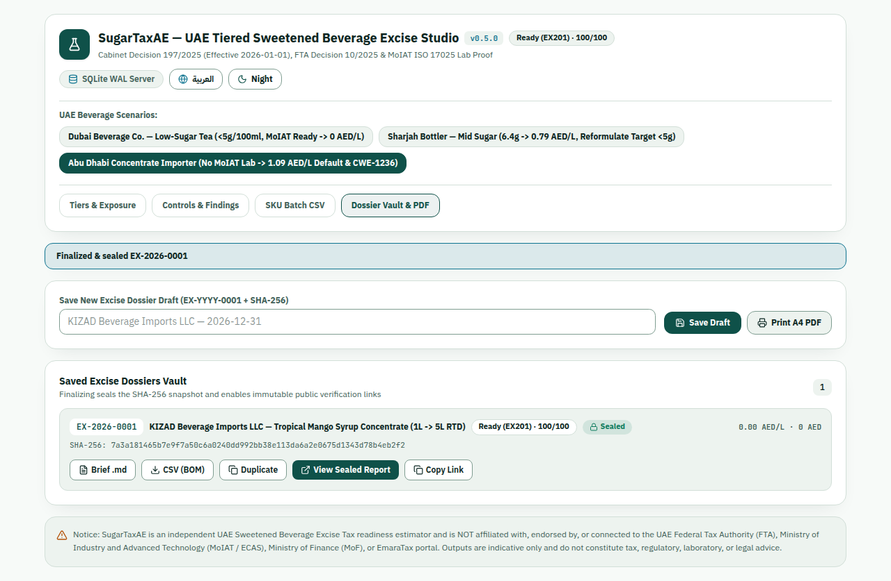
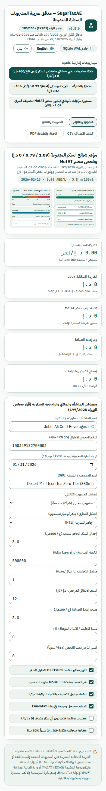
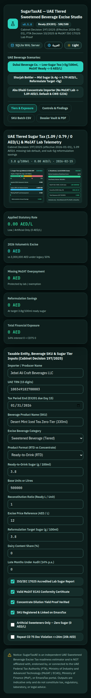

# SugarTaxAE — مدقق ضريبة المشروبات المحلاة المتدرجة الإماراتي

[](LICENSE)

> **Bilingual (`AR RTL` `Palm Alabaster` Light & `EN LTR` `Excise Night` Dark) · Dual-Mode (`Node 22 + SQLite WAL` or `$0` Browser Static Mode)**

Zero-runtime-backend-dependency UAE Tiered Volumetric Sweetened Beverages Excise Tax readiness studio, `node:sqlite WAL` REST API server, and bilingual **Arabic (`RTL`) / English (`LTR`)** web workbench grounded in **UAE Cabinet Decision No. (197) of 2025** (effective **`2026-01-01`**) and **FTA Decision No. (10) of 2025**:

- **Volumetric Sugar Tiers (`AED 1.09 / 0.79 / 0 per Litre`)**: Classifies `>= 8g/100ml` at **`AED 1.09/L`**, `5g to <8g/100ml` at **`AED 0.79/L`**, and `<5g/100ml` or artificial sweeteners only at **`AED 0.00/L`** (ensuring artificial sweeteners never offset real sugar when combined).
- **MoIAT ISO 17025 Lab & ECAS Strict Default Rule (`FTA 10/2025`)**: Enforces the statutory **`AED 1.09/L`** default whenever an accredited ISO/IEC 17025 lab report, MoIAT ECAS certificate, or concentrate dilution yield sheet is missing, and quantifies the avoidable overpayment exposure.
- **Carve-Outs, Energy Drinks & Concentrates**: Keeps energy drinks on the flat **`100%`** rate, models **`>= 75%`** dairy and **`100%`** natural fruit/vegetable juice (without added sugar/sweeteners) exemptions, and computes final ready-to-drink litres for liquid concentrates, powders, and gels.
- **EmaraTax EX201 Day-15 SLA & Reformulation Simulator**: Computes monthly EmaraTax EX201 due dates (`15th` of the following month), models **`14% p.a.`** late-payment interest + **`AED 10,000 / 20,000`** recordkeeping penalties (`CD 75/2023`), and simulates annual tax savings from sugar reformulation below `5g/100ml`.
- **CWE-1236 Safe Multi-SKU CSV Auditor & Sealed Dossiers**: Neutralizes formula injection payloads (`=`, `+`, `-`, `@`, `\t`, `\r`), exports Excel-ready **`UTF-8 BOM` (`EF BB BF`) + `CRLF`** CSVs, mints atomic `EX-YYYY-0001` dossiers with canonical **`SHA-256`** sealing (`409` immutable after lock), and serves read-only `/r/:slugOrCode` verification reports.

> **Independence & Legal Disclaimer / تنويه مهم:** SugarTaxAE is an independent open-source UAE Sweetened Beverage Excise Tax readiness estimator and is **NOT affiliated with, endorsed by, or connected to** the UAE Federal Tax Authority (`FTA`), Ministry of Industry and Advanced Technology (`MoIAT / ECAS`), Ministry of Finance (`MoF`), or `EmaraTax` portal. Outputs are indicative only and do not constitute tax, regulatory, laboratory, or legal advice.

---

## Visual Showcase (`AR RTL` & `EN LTR`)

### Desktop Arabic RTL (`Palm Alabaster` Light — Dubai Low-Sugar `<5g -> 0 AED/L` `100/100`)


### Desktop English LTR (`Excise Night` Dark)


### Sharjah Bottler Moderate Tier (`6.4g/100ml -> 0.79 AED/L`, AED 158k Reformulation Savings)


### Remediated Abu Dhabi Concentrate & Sealed `EX-2026-0001` Dossier (`SHA-256`)


### Mobile Arabic RTL View (`Palm Alabaster`, `390x844`)


### Mobile English LTR View (`Excise Night`, `390x844`)


---

## Quick Start (Local)

```bash
npm install
npm run typecheck
npm test
npm run build
npm start
# Opens HTTP + node:sqlite WAL backend on http://127.0.0.1:4237/sugartaxae
```

See [`launch/DEPLOY-AND-SHARE.md`](launch/DEPLOY-AND-SHARE.md) for `$0` Cloudflare Workers static deployment, Docker Compose, and systemd setup.

## License

[MIT](LICENSE)
